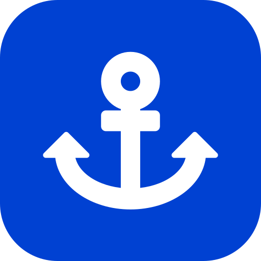
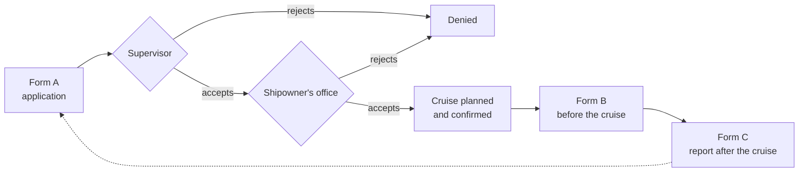

<div align="center">



# ResearchCruiseApp

Booking, planning and reporting research cruises aboard r/v _Oceanograf_,
the research vessel of the University of Gdańsk.

[](https://github.com/VV01T3K/ResearchCruiseApp/releases)
[](https://github.com/VV01T3K/ResearchCruiseApp/actions/workflows/deploy-staging.yaml)
[](LICENSE)

</div>

Scientists apply for ship time, their supervisors approve the request, the shipowner's office
scores the applications and builds the yearly schedule, and each cruise is described before
departure and reported after return. The app replaces the paper forms and email threads that used
to carry this process. Its interface is in Polish.

## How it works



- **Form A** is the application: research goals, team, equipment, permits and preferred dates. It
  can be saved as a draft.
- The **supervisor** accepts or rejects it from a link sent by email, without an account.
- The **shipowner's office** ranks applications by points and plans cruises from the accepted ones.
- **Form B** collects the final crew, equipment and tasks once the cruise is confirmed.
- **Form C** reports what was done. The reported effects and the team's publications earn points
  for future applications.

Access depends on the role: administrator, shipowner, cruise manager, ship crew or guest.

## Stack

|          |                                                                                               |
| -------- | --------------------------------------------------------------------------------------------- |
| Frontend | React 19, TypeScript, TanStack Router, Query, Form and Table, Base UI, Tailwind CSS           |
| Backend  | .NET 10 minimal APIs, Entity Framework Core, ASP.NET Core Identity, SQL Server 2022           |
| Contract | The backend generates an OpenAPI document; Orval turns it into the typed client and schemas   |
| Tests    | Vitest, Storybook, Playwright, xUnit v3 with SQL Server in Testcontainers                     |
| Tooling  | [Vite+](https://viteplus.dev/) (`vp`), Bun, [mise](https://mise.jdx.dev/), Lefthook, Renovate |
| Hosting  | Docker Compose, nginx, GitHub Actions, Sentry                                                 |

## Quick start

You need [mise](https://mise.jdx.dev/) and Docker (or rootless Podman). mise installs Bun, Vite+
and the .NET SDK at the versions the repository pins. A [dev container](.devcontainer) with
everything preinstalled is also provided.

```sh
git clone https://github.com/VV01T3K/ResearchCruiseApp.git
cd ResearchCruiseApp
mise trust && mise install   # tools, dependencies and the Playwright browser
mise run seed                # fresh SQL Server container with seed accounts
vp run dev                   # backend on :3000, frontend on :5173
```

Open <http://localhost:5173> and sign in with an account from `credentials.log`, which
`mise run seed` writes to the repository root. Emails are not sent in development; they are
written as HTML files to `fake-emails/`.

To run everything in containers instead:

```sh
docker compose -f docker/docker-compose.dev.yml up --build
```

The app is then on <http://localhost:8080> and the seed passwords are in the backend log.

## Development

Run commands from the repository root.

| Command                           | What it does                                                      |
| --------------------------------- | ----------------------------------------------------------------- |
| `vp run dev`                      | Backend with `dotnet watch` and the Vite dev server               |
| `vp run check`                    | Formatting, lint and type checks; rebuilds the OpenAPI document   |
| `vp run fix`                      | Applies formatting and lint fixes                                 |
| `vp run gen`                      | Regenerates the frontend API client from the OpenAPI document     |
| `vp run -F backend test`          | Backend unit and integration tests (run `vp run check` first)     |
| `vp run -F frontend test:unit`    | Frontend unit tests                                               |
| `vp run -F frontend test:browser` | Playwright journeys against a production build with a mocked API  |
| `vp run -F frontend storybook`    | Component workshop; `test:storybook` runs the stories as tests    |
| `vp run ef:migration:add <Name>`  | Adds an Entity Framework migration                                |
| `mise run db:up`, `db:down`       | Starts or stops the database container; `db:del` deletes its data |

```text
backend/
  ResearchCruiseApp/                   API: endpoints in Api/, entities in Domain/,
                                       EF Core, email and identity in Infrastructure/
  ResearchCruiseApp.UnitTests/
  ResearchCruiseApp.IntegrationTests/  real HTTP against SQL Server in a container
frontend/
  src/routes/                          pages (TanStack Router file routes)
  src/features/                        code shared by several routes
  src/api/generated/                   Orval output, committed, never edited by hand
  stories/                             Storybook stories
  tests/                               unit tests and Playwright journeys
docker/                                Compose files and environment templates
.github/                               CI, release and deploy workflows
```

### Contributing

- Branch from `staging` and open the pull request against it. `main` only moves on a release.
- Write [Conventional Commits](https://www.conventionalcommits.org/), for example
  `fix(forms): keep focused fields visible`.
- When the API changes, run `vp run check` and `vp run gen` and commit the OpenAPI document and
  the generated client with the change.
- Lefthook formats staged files on commit. CI runs the checks, both test suites and the
  Playwright journeys on every pull request.

[AGENTS.md](AGENTS.md) holds the rules for coding agents working in this repository.

## Deployment

Every merge to `staging` builds images and deploys them to the staging server. A release tags a
`staging` commit as `vX.Y.Z`, fast-forwards `main` to it and builds the production images; see
[Releasing](docs/releasing.md).

Production runs [`docker/compose.production.yaml`](docker/compose.production.yaml) with the
settings from [`docker/.env.production.template`](docker/.env.production.template). The template
lists every setting with a comment and the Compose file refuses to start without the required
ones. Staging uses `compose.staging.yaml` and `.env.staging.template` the same way.

Production uses the client's own SQL Server, outside these files: SQL Server 2022 RTM
(16.0.1000.6) as of November 2026. Staging, development and the integration tests run the latest
SQL Server 2022 CU.

- **Database migrations** run on startup only when `DATABASE_APPLY_MIGRATIONS=true`. Otherwise the
  backend refuses to start while migrations are pending and logs their names. To upgrade, back up
  the database, start the new version once with the flag on, then turn it off again.
- **Email** needs `SMTP_USERNAME` and `SMTP_PASSWORD` (a Gmail app password) in the deployment
  environment, never in a tracked file. Messages are queued in the database and retried by a
  background worker, so a mail outage delays them but does not fail the user's request.
- **Sentry** is off until `SENTRY_DSN_FRONTEND` and `SENTRY_DSN_BACKEND` are set.

The university's IT follows [the production upgrade guide](docs/wdrozenie-produkcyjne.md) (in
Polish).

## Team

ResearchCruiseApp is built by students of the University of Gdańsk as a group project and
engineering thesis for the university's shipowner's office. The contributors are listed in
[LICENSE](LICENSE); the coursework documents of both teams are in [`docs/`](docs).

Released under the [MIT License](LICENSE).
