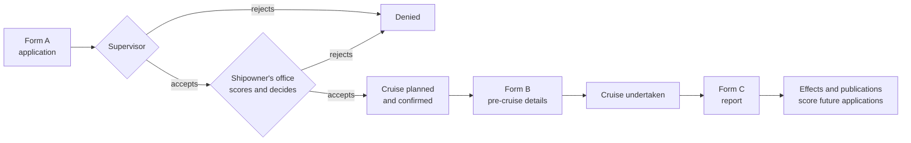

<div align="center">


# ResearchCruiseApp

**Booking, planning and reporting research cruises aboard r/v _Oceanograf_**

Built for the [Institute of Oceanography, University of Gdańsk](https://oceanografia.ug.edu.pl/)

[](https://github.com/VV01T3K/ResearchCruiseApp/releases)
[](https://github.com/VV01T3K/ResearchCruiseApp/actions/workflows/deploy-staging.yaml)
[](https://github.com/VV01T3K/ResearchCruiseApp/actions/workflows/playwright.yaml)
[](https://github.com/VV01T3K/ResearchCruiseApp/actions/workflows/dependency-audit.yaml)
[](LICENSE)

[Features](#features) · [How it works](#how-it-works) · [Quick start](#quick-start) · [Development](#development) · [Documentation](#documentation)

</div>

---

## About

ResearchCruiseApp replaces the paper and email workflow around the university's research vessel. Scientists apply for ship time, their supervisors approve the request, the shipowner's office scores and schedules applications, and each cruise is documented before departure and reported after return, all in one place with a full history.

The interface is in Polish, for the university's staff and partners.

## Features

- **Cruise applications (Form A)**: research goals, team, equipment, permits, ports and preferred dates, saved as drafts until submitted.
- **Supervisor approval**: supervisors accept or reject an application from a link sent by email, without an account.
- **Scoring and prioritisation**: applications earn points from past cruise effects and the team's publications, so the office can rank competing requests.
- **Cruise planning**: build the yearly schedule from accepted applications, auto-plan cruises, warn about blocked periods and export the plan to CSV.
- **Pre-cruise details (Form B)** and **post-cruise reports (Form C)**: crew, equipment and research tasks before departure, then samples, collected data and effects after return.
- **Publications and effects**: each scientist keeps a list of publications and cruise effects that feeds future scoring, with CSV import.
- **Accounts and roles**: registration with email confirmation, password reset, and role-based access for administrators, the shipowner's office, cruise managers, ship crew and guests (see the [permission matrix](docs/permissions.md)).
- **Printable forms**, an in-app help page and a "report a problem" button wired to Sentry.

## How it works



Application statuses follow the same path: `Draft` → `WaitingForSupervisor` → `AcceptedBySupervisor` → `Accepted` → `FormBRequired` → `FormBFilled` → `Undertaken` → `Reported`. Cruises move from `New` to `Confirmed` to `Ended`.

## Tech stack

| Layer     | Technology                                                                                                               |
| --------- | ------------------------------------------------------------------------------------------------------------------------ |
| Frontend  | React 19, TypeScript, TanStack Router, Query, Form and Table, Base UI, Tailwind CSS, Zod                                 |
| API layer | OpenAPI document generated by the backend; [Orval](https://orval.dev/) generates the typed client, hooks and Zod schemas |
| Backend   | .NET 10, ASP.NET Core minimal APIs, Entity Framework Core, ASP.NET Core Identity with JWT                                |
| Database  | Microsoft SQL Server 2022                                                                                                |
| Tooling   | [Vite+](https://viteplus.dev/), Bun, mise, Oxlint and Oxfmt, Lefthook, Renovate                                          |
| Testing   | Vitest, Storybook, Playwright, xUnit v3 with Testcontainers                                                              |
| Ops       | Docker Compose, nginx, GitHub Actions, GHCR images, Sentry                                                               |

## Quick start

### Prerequisites

- [mise](https://mise.jdx.dev/), which installs Bun, Vite+ and the .NET SDK pinned by the repository
- Docker, or rootless Podman (see [backend development](docs/backend-development.md#backend-development-and-checks))

A [dev container](.devcontainer/devcontainer.json) with everything preinstalled is also provided.

### Run locally

```sh
git clone https://github.com/VV01T3K/ResearchCruiseApp.git
cd ResearchCruiseApp
mise trust && mise install   # tools, dependencies and the Playwright browser
mise run seed                # fresh SQL Server container and seed accounts
vp run dev                   # backend on :3000, frontend on :5173
```

Open <http://localhost:5173> and sign in with an account from `credentials.log`, which `mise run seed` writes to the repository root. Outgoing emails are written to files instead of being sent.

### Run with Docker only

```sh
docker compose -f docker/docker-compose.dev.yml up --build
```

The frontend is served on <http://localhost:8080> and the backend on <http://localhost:3000>. Seed account passwords are printed in the backend log.

## Development

### Commands

Run these from the repository root.

| Command                        | What it does                                                  |
| ------------------------------ | ------------------------------------------------------------- |
| `vp run dev`                   | Backend with `dotnet watch` and the Vite dev server           |
| `vp run build`                 | Production builds of both applications                        |
| `vp run check`                 | Formatting, lint and type checks; regenerates the OpenAPI doc |
| `vp run fix`                   | Applies formatting and lint fixes                             |
| `vp run gen`                   | Regenerates the frontend API client from the OpenAPI document |
| `vp run -F backend test`       | Backend unit and SQL Server integration tests                 |
| `vp run -F frontend test`      | Frontend unit, Storybook and Playwright tests                 |
| `mise run db:up` / `db:down`   | Starts or stops the database container                        |
| `mise run db:del`              | Deletes the database volume                                   |
| `vp run ef:migration:add Name` | Adds an Entity Framework migration                            |

### Project structure

```text
.
├── backend/
│   ├── ResearchCruiseApp/                  # ASP.NET Core API
│   │   ├── Api/                            # Endpoints: Applications, Auth, Cruises, Users
│   │   ├── Application/                    # Use cases and business rules
│   │   ├── Domain/                         # Entities and enums
│   │   ├── Infrastructure/                 # EF Core, migrations, email, identity
│   │   └── openapi/                        # Generated OpenAPI document (committed)
│   ├── ResearchCruiseApp.UnitTests/
│   └── ResearchCruiseApp.IntegrationTests/ # Real HTTP and SQL Server in a container
├── frontend/
│   ├── src/
│   │   ├── api/generated/                  # Orval client (committed)
│   │   ├── routes/                         # TanStack Router file routes
│   │   ├── features/                       # Code shared by several routes
│   │   └── integrations/                   # TanStack adapters and helpers
│   ├── stories/                            # Storybook stories
│   └── tests/                              # Unit and Playwright browser tests
├── docker/                                 # Compose files for dev, staging and production
└── docs/                                   # Project documentation
```

### Workflow

1. Branch from `staging` and open a pull request against it.
2. Write commits as [Conventional Commits](https://www.conventionalcommits.org/), for example `fix(forms): keep focused fields visible`.
3. Lefthook formats staged files on commit. CI runs `vp run check`, the backend and frontend tests and the Playwright journeys on every push; a dependency audit runs nightly.
4. When the backend contract changes, commit the regenerated OpenAPI document and the output of `vp run gen` together.

Merges to `staging` deploy to the staging server. Releases are tagged from `staging` and promoted to `main`; see [Releasing](docs/releasing.md).

## Documentation

| Topic                                                               | Contents                                                    |
| ------------------------------------------------------------------- | ----------------------------------------------------------- |
| [Configuration and deployment](docs/configuration.md)               | Environment variables, migrations, seeding, Docker Compose  |
| [Backend development](docs/backend-development.md)                  | Setup, checks and the backend test suites                   |
| [Frontend](frontend/README.md)                                      | Frontend commands and the design system rules               |
| [Frontend testing](frontend/TESTING.md)                             | Test layers and when to use each                            |
| [Permissions](docs/permissions.md)                                  | What each role may do, per endpoint (Polish)                |
| [Releasing](docs/releasing.md)                                      | Versions, tags and promoting a release                      |
| [Dependency maintenance](docs/dependency-maintenance.md)            | Installs, audits and Renovate                               |
| [SMTP configuration](docs/smtp-configuration.md)                    | Mail account setup, rotation and verification               |
| [Email delivery](docs/email-delivery.md)                            | The outbox and how emails are sent                          |
| [Production upgrade](docs/wdrozenie-produkcyjne.md)                 | Step-by-step upgrade guide for the university's IT (Polish) |
| [Sentry on-prem migration](docs/sentry/sentry-on-prem-migration.md) | Moving to a self-hosted Sentry instance                     |

Releases and their notes are on the [Releases page](https://github.com/VV01T3K/ResearchCruiseApp/releases); [CHANGELOG.md](CHANGELOG.md) keeps the history up to 3.0.0.

## Authors

ResearchCruiseApp is developed as a student group and engineering-thesis project for the shipowner's office of the University of Gdańsk. Their process documents are in [`docs/previous-team`](docs/previous-team) and [`docs/our-team`](docs/our-team), and the contributors are listed in [LICENSE](LICENSE).

## License

Released under the [MIT License](LICENSE).
