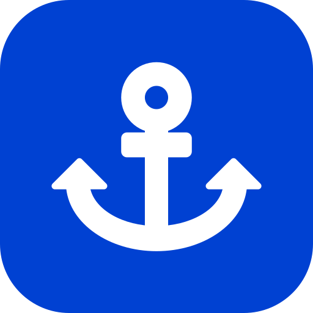
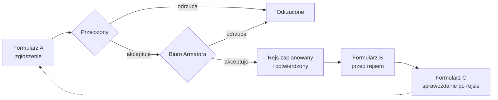

<p align="right"><a href="README.md"></a></p>

<div align="center">



# ResearchCruiseApp

Zgłaszanie, planowanie i rozliczanie rejsów badawczych r/v _Oceanograf_, Uniwersytet Gdański

[](https://github.com/VV01T3K/ResearchCruiseApp/actions/workflows/deploy-staging.yaml)
[](https://github.com/VV01T3K/ResearchCruiseApp/releases)
[](https://github.com/VV01T3K/ResearchCruiseApp/releases)
<br>
[](https://github.com/VV01T3K/ResearchCruiseApp/actions/workflows/dependency-audit.yaml)
[](LICENSE)

</div>

Naukowcy zgłaszają zapotrzebowanie na czas statkowy, ich przełożeni zatwierdzają zgłoszenie, Biuro
Armatora punktuje zgłoszenia i układa roczny harmonogram, a każdy rejs jest opisywany przed
wypłynięciem i rozliczany po powrocie. Aplikacja zastępuje papierowe formularze i korespondencję
mailową, którymi dotąd prowadzono ten proces.

## Jak to działa



- **Formularz A** to zgłoszenie: cele badań, zespół, sprzęt, pozwolenia i preferowane terminy.
  Można go zapisać jako wersję roboczą.
- **Przełożony** akceptuje lub odrzuca je z linku w wiadomości e-mail, bez zakładania konta.
- **Biuro Armatora** szereguje zgłoszenia według punktów i planuje rejsy z zaakceptowanych.
- **Formularz B** zbiera ostateczny skład, sprzęt i zadania po potwierdzeniu rejsu.
- **Formularz C** opisuje, co zrobiono. Zgłoszone efekty i publikacje zespołu dają punkty przy
  kolejnych zgłoszeniach.

Dostęp zależy od roli: administrator, armator, kierownik rejsu, załoga lub gość.

## Technologie

| Warstwa   | Technologia                                                                                   |
| --------- | --------------------------------------------------------------------------------------------- |
| Frontend  | React 19, TypeScript, TanStack Router, Query, Form i Table, Base UI, Tailwind CSS             |
| Backend   | .NET 10 minimal APIs, Entity Framework Core, ASP.NET Core Identity, SQL Server 2022           |
| Kontrakt  | Backend generuje dokument OpenAPI; Orval tworzy z niego typowany klient i schematy            |
| Testy     | Vitest, Storybook, Playwright, xUnit v3 z SQL Server w Testcontainers                         |
| Narzędzia | [Vite+](https://viteplus.dev/) (`vp`), Bun, [mise](https://mise.jdx.dev/), Lefthook, Renovate |
| Hosting   | Docker Compose, nginx, GitHub Actions, Sentry                                                 |

## Szybki start

Potrzebne są [mise](https://mise.jdx.dev/) i Docker. mise instaluje Bun, Vite+ i .NET SDK w
wersjach przypiętych w repozytorium. Dostępny jest też [dev container](.devcontainer) ze wszystkim
zainstalowanym.

```sh
git clone https://github.com/VV01T3K/ResearchCruiseApp.git
cd ResearchCruiseApp
mise trust && mise install   # narzędzia, zależności i przeglądarka dla Playwright
mise run seed                # nowy kontener SQL Server z kontami testowymi
vp run dev                   # backend na :3000, frontend na :5173
```

Otwórz <http://localhost:5173> i zaloguj się kontem z pliku `credentials.log`, który `mise run seed`
zapisuje w katalogu głównym repozytorium. W trybie deweloperskim e-maile nie są wysyłane, tylko
zapisywane jako pliki HTML w `fake-emails/`.

Wszystko w kontenerach:

```sh
docker compose -f docker/docker-compose.dev.yml up --build
```

Aplikacja działa wtedy pod <http://localhost:8080>, a hasła kont testowych są w logu backendu.

## Praca nad kodem

Polecenia uruchamia się z katalogu głównego repozytorium.

| Polecenie                         | Działanie                                                       |
| --------------------------------- | --------------------------------------------------------------- |
| `vp run dev`                      | Backend z `dotnet watch` i serwer deweloperski Vite             |
| `vp run check`                    | Formatowanie, lint i typy; odświeża dokument OpenAPI            |
| `vp run fix`                      | Poprawia formatowanie i błędy lintera                           |
| `vp run gen`                      | Generuje klienta API frontendu z dokumentu OpenAPI              |
| `vp run -F backend test`          | Testy jednostkowe i integracyjne backendu (po `vp run check`)   |
| `vp run -F frontend test:unit`    | Testy jednostkowe frontendu                                     |
| `vp run -F frontend test:browser` | Scenariusze Playwright na buildzie produkcyjnym z atrapą API    |
| `vp run -F frontend storybook`    | Katalog komponentów; `test:storybook` uruchamia je jako testy   |
| `vp run ef:migration:add <Nazwa>` | Dodaje migrację Entity Framework                                |
| `mise run db:up`, `db:down`       | Uruchamia lub zatrzymuje kontener bazy; `db:del` usuwa jej dane |

| Ścieżka                                       | Zawartość                                                      |
| --------------------------------------------- | -------------------------------------------------------------- |
| `backend/ResearchCruiseApp/`                  | API: endpointy, domena, EF Core, e-mail i tożsamość            |
| `backend/ResearchCruiseApp.UnitTests/`        | Testy jednostkowe backendu                                     |
| `backend/ResearchCruiseApp.IntegrationTests/` | Prawdziwe HTTP na SQL Server w kontenerze                      |
| `frontend/src/routes/`                        | Strony (trasy plikowe TanStack Router)                         |
| `frontend/src/features/`                      | Kod używany przez kilka tras                                   |
| `frontend/src/api/generated/`                 | Wygenerowany klient API, w repozytorium, nie edytowany ręcznie |
| `frontend/stories/`, `frontend/tests/`        | Historie Storybook, testy jednostkowe i scenariusze Playwright |
| `docker/`, `.github/`                         | Pliki Compose, szablony środowisk, CI i wydania                |

## Wdrożenie

Każde scalenie do `staging` buduje obrazy i wdraża je na serwer testowy. Wydanie oznacza commit z
`staging` tagiem `vX.Y.Z`, przesuwa na niego `main` i buduje obrazy produkcyjne; zob.
[Releasing](docs/releasing.md).

Produkcja działa na [`docker/compose.production.yaml`](docker/compose.production.yaml) z
ustawieniami z [`docker/.env.production.template`](docker/.env.production.template). Szablon
opisuje każde ustawienie, a Compose nie wystartuje bez wymaganych. Staging korzysta tak samo z
`compose.staging.yaml` i `.env.staging.template`.

Produkcja używa własnego SQL Server klienta, spoza tych plików: SQL Server 2022 RTM (16.0.1000.6)
według stanu z listopada 2026. Staging, środowisko deweloperskie i testy integracyjne działają na
najnowszym CU SQL Server 2022.

- **Migracje bazy** uruchamiają się przy starcie tylko przy `DATABASE_APPLY_MIGRATIONS=true`. W
  przeciwnym razie backend nie wystartuje, dopóki są oczekujące migracje, i wypisze ich nazwy w
  logach. Aktualizacja: kopia zapasowa bazy, jeden start nowej wersji z flagą włączoną, potem
  wyłączenie flagi.
- **E-mail** wymaga `SMTP_USERNAME` i `SMTP_PASSWORD` (hasło aplikacji Gmail) w środowisku
  wdrożenia, nigdy w pliku w repozytorium. Wiadomości trafiają do kolejki w bazie i są ponawiane
  przez proces w tle, więc awaria poczty opóźnia je, ale nie przerywa działania użytkownika.
- **Sentry** jest wyłączone, dopóki nie ustawi się `SENTRY_DSN_FRONTEND` i `SENTRY_DSN_BACKEND`.

Dział IT uczelni korzysta z [instrukcji aktualizacji produkcji](docs/wdrozenie-produkcyjne.md).

## Zespół

ResearchCruiseApp tworzą studenci Uniwersytetu Gdańskiego w ramach projektu grupowego i pracy
inżynierskiej dla Biura Armatora uczelni. Autorzy są wymienieni w pliku [LICENSE](LICENSE).

Udostępnione na [licencji MIT](LICENSE).
